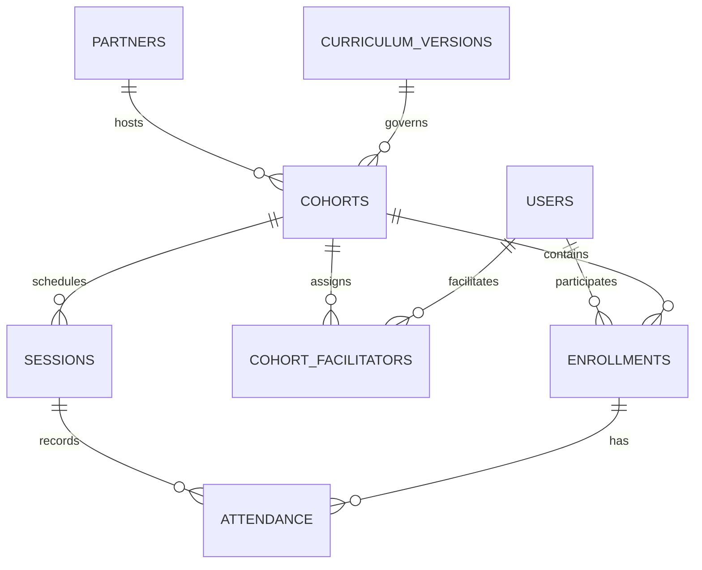
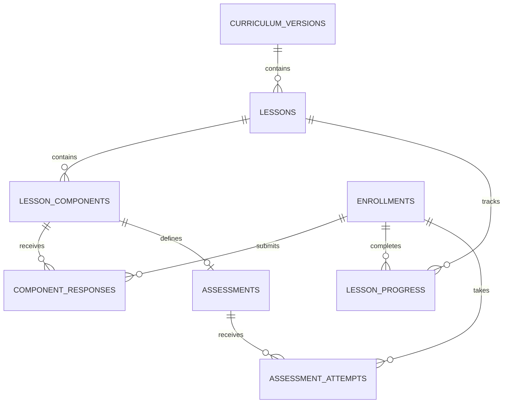
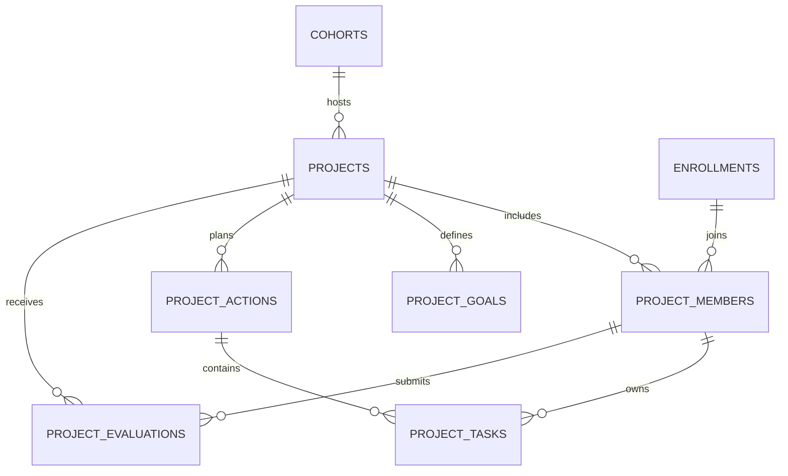

# Called to Thrive — Database Design

Version 1 · 3 October 2026 · Proposed implementation design

## 1. Scope and assumptions

This design implements the agreed participant, facilitator and OneHope administrator journeys. The attached Uganda workbook is the source for the 15-lesson curriculum. Each cohort uses one immutable published curriculum version. No public curriculum version is mixed into it.

Use a relational database. The type notation below targets PostgreSQL, but the relationships can also be implemented in MySQL. This is a logical/physical design specification, not an executable migration or a deployed database.

V1 includes accounts, partners, cohorts, sessions, attendance, curriculum, responses, career assessment, community projects and reporting. Google Meet is an external link. Chat, video hosting, generic course creation, social networking and offline synchronization are outside this schema's V1 scope.

Assumptions requiring programme agreement before implementation: facilitators require admin approval; participants may enrol in multiple cohorts over time; a cohort may have several project teams; personal reflections default to private; attendance is not a mandatory completion criterion unless OneHope approves a rule.

## 2. Conventions

Every entity table uses `id UUID PRIMARY KEY`, `created_at TIMESTAMPTZ NOT NULL`, and `updated_at TIMESTAMPTZ NOT NULL`, unless a composite primary key is specified. Generate timestamps server-side and store instants in UTC. Display session times in the cohort's timezone, default `Africa/Kampala`. Calendar dates use DATE.

Notation: FK means foreign key; UQ means unique constraint; ? means nullable. All other fields are required unless a default is supplied. TEXT is variable-length text; JSONB is structured JSON. Use foreign keys with RESTRICT for programme history; cascade only child records during an explicitly authorised purge. Do not cascade-delete a user and their programme records.

## 3. Relationships

## 4. Accounts and geography

| Table | Fields beyond common columns | Constraints / purpose |
|---|---|---|
| `users` | full_name TEXT; email TEXT?; phone_e164 TEXT?; password_hash TEXT; status TEXT default active; email_verified_at TIMESTAMPTZ?; phone_verified_at TIMESTAMPTZ? | At least one contact required. Case-insensitive UQ normalized email; UQ normalized phone. status: active/suspended/archived. Password hashing is handled by the authentication framework. |
| `user_roles` | user_id FK users; role TEXT | Composite PK (user_id, role); participant/facilitator/admin. One person can hold several roles. Role alone never grants access to every cohort. |
| `participant_profiles` | user_id FK users UQ; date_of_birth DATE?; gender TEXT?; district_id FK districts? | Optional demographics; do not require unnecessary personal data at sign-up. |
| `facilitator_profiles` | user_id FK users UQ; approval_status TEXT default pending; approved_by FK users?; approved_at TIMESTAMPTZ? | pending/approved/rejected/suspended. A completed approval needs approver and timestamp. |
| `regions` | name TEXT UQ | Uganda reporting geography. |
| `districts` | region_id FK regions; name TEXT | UQ (region_id, name). |
| `partners` | name TEXT; organisation_type TEXT; district_id FK districts?; status TEXT default active | church/school/ministry/other; active/archived. Do not use organisation name as its identifier. |
| `partner_facilitators` | partner_id FK partners; facilitator_user_id FK users; status TEXT default active | Composite PK (partner_id, facilitator_user_id); active/inactive. Facilitators may serve more than one partner. |

Authentication sessions, password resets and verification tokens should use the chosen framework's standard tables; they are not curriculum entities. Unverified contact details must not enable account takeover through recovery.

## 5. Cohorts and meetings

| Table | Fields beyond common columns | Constraints / purpose |
|---|---|---|
| `cohorts` | partner_id FK partners; district_id FK districts; curriculum_version_id FK curriculum_versions; name TEXT; start_date DATE; end_date DATE?; status TEXT default planned; timezone TEXT default Africa/Kampala; default_meeting_type TEXT; default_meet_url TEXT?; current_lesson_id FK lessons?; completed_at TIMESTAMPTZ? | planned/active/completed/cancelled/archived. end_date >= start_date. physical/online/hybrid. District describes delivery location, not necessarily partner HQ. Current lesson is a facilitator-set cohort position, not an individual's completion. |
| `cohort_facilitators` | cohort_id FK cohorts; facilitator_user_id FK users; assignment_role TEXT; assigned_at TIMESTAMPTZ; ended_at TIMESTAMPTZ? | Composite PK (cohort_id, facilitator_user_id). lead/assistant. One active lead per cohort, enforced with a partial unique index. Approval and partner affiliation checked when assigning. |
| `cohort_invites` | cohort_id FK cohorts; code_digest TEXT UQ; expires_at TIMESTAMPTZ?; revoked_at TIMESTAMPTZ?; max_uses INTEGER?; use_count INTEGER default 0; created_by FK users | Store a digest of a random, sufficiently long join token. Join link/code resolves the same invite. Atomic redemption prevents exceeding use limits. Codes can rotate without changing cohort identity. |
| `enrollments` | cohort_id FK cohorts; participant_user_id FK users; status TEXT default active; joined_at TIMESTAMPTZ; completed_at TIMESTAMPTZ?; withdrawn_at TIMESTAMPTZ? | UQ (cohort_id, participant_user_id). active/completed/withdrawn. All learning records reference enrollment, so a repeat programme does not overwrite earlier answers. |
| `sessions` | cohort_id FK cohorts; lesson_id FK lessons?; title TEXT; starts_at TIMESTAMPTZ; ends_at TIMESTAMPTZ?; meeting_type TEXT; meet_url TEXT?; venue TEXT?; status TEXT default scheduled; attendance_finalized_at TIMESTAMPTZ?; conducted_by FK users? | scheduled/completed/cancelled. ends_at > starts_at. online needs Meet URL; physical needs venue; hybrid needs both. Multiple sessions may cover the same lesson. Orientation may have no lesson. |
| `attendance` | session_id FK sessions; enrollment_id FK enrollments; status TEXT; recorded_by FK users; recorded_at TIMESTAMPTZ | UQ (session_id, enrollment_id). present/absent/excused. Missing row means unrecorded, never automatically absent. |

Within a transaction, membership and access checks must ensure attendance enrollment and session belong to the same cohort. Use composite foreign keys or database triggers to enforce this invariant, alongside application authorization.

## 6. Curriculum and participant work

| Table | Fields beyond common columns | Constraints / purpose |
|---|---|---|
| `curriculum_versions` | code TEXT UQ; title TEXT; source_reference TEXT; language_code TEXT default en; status TEXT default draft; published_at TIMESTAMPTZ?; completion_policy JSONB | draft/published/retired. Source reference identifies the approved workbook. Completion policy declares required lesson/project criteria. Published content is immutable; corrections create a new version. |
| `lessons` | curriculum_version_id FK curriculum_versions; lesson_number SMALLINT; title TEXT; summary TEXT? | UQ (curriculum_version_id, lesson_number); number > 0. Do not hard-code 15 into the database. |
| `lesson_components` | lesson_id FK lessons; component_key TEXT; display_order SMALLINT; component_type TEXT; title TEXT; participant_content JSONB; facilitator_content JSONB?; response_schema JSONB?; required BOOLEAN default false; completion_method TEXT; visibility TEXT default private | UQ (lesson_id, component_key), UQ (lesson_id, display_order). Types: truth/scripture/vocabulary/teaching/discussion/activity/life_work/assessment/project_milestone. Methods: acknowledgment/submission/facilitator_confirmation/assessment/project_milestone. Visibility: private/facilitator/project_team. |
| `component_responses` | enrollment_id FK enrollments; component_id FK lesson_components; payload JSONB?; status TEXT default draft; submitted_at TIMESTAMPTZ?; completed_at TIMESTAMPTZ?; confirmed_by FK users?; revision INTEGER default 1 | UQ (enrollment_id, component_id). draft/submitted/completed/returned. JSON validated against the component's fixed response schema. Stores acknowledgment or discussion confirmation even if no written payload is appropriate. |
| `lesson_progress` | enrollment_id FK enrollments; lesson_id FK lessons; started_at TIMESTAMPTZ?; completed_at TIMESTAMPTZ?; completion_method TEXT?; override_reason TEXT?; confirmed_by FK users? | UQ (enrollment_id, lesson_id). Completion: requirements/override. Override needs reason and authorized facilitator. Absence of a row means not started. |

Goals, strengths, weaknesses, skills, mentorship plans and résumé exercises are typed response payloads in V1, not separate unrelated feature systems. Example mentorship response: `{areas: [...], potential_mentor: "...", reason: "...", approach: "..."}`. If a later release adds editable goals or a Thrive Profile, derive it from these authoritative answers or deliberately promote selected fields to relational tables.

Structured JSON is suitable for workbook answers and content; users, cohorts, memberships, dates, attendance, assessment scores and project tasks stay relational. There is no runtime generic form builder in V1.

Reading a lesson does not mark it complete. Explicit acknowledgment may complete a reading component; an activity needs valid submission; a facilitated discussion may need facilitator confirmation. Recompute lesson completion in the same transaction as component completion. Session completion does not complete a participant's Life Work.

An enrollment's cohort version must match its lesson/component version. Enforce using triggers or composite foreign keys; never accept a component ID solely because it exists.

## 7. Career assessment

The uploaded Lesson 5 quiz has 24 questions scored 1–5 and six categories, each containing four questions. Store individual answers, not just the winning category.

| Table | Fields beyond common columns | Constraints / purpose |
|---|---|---|
| `assessments` | component_id FK lesson_components UQ; code TEXT; scoring_version TEXT; min_answer SMALLINT; max_answer SMALLINT | One fixed assessment per assessment component. Quiz scale 1–5; approved rules versioned with curriculum. |
| `assessment_categories` | assessment_id FK assessments; code TEXT; label TEXT; description TEXT? | UQ (assessment_id, code). |
| `assessment_questions` | assessment_id FK assessments; category_id FK assessment_categories; question_number SMALLINT; prompt TEXT | UQ (assessment_id, question_number). Category must belong to this assessment. |
| `assessment_attempts` | enrollment_id FK enrollments; assessment_id FK assessments; attempt_number INTEGER; status TEXT default draft; submitted_at TIMESTAMPTZ?; scoring_version TEXT | UQ (enrollment_id, assessment_id, attempt_number); draft/submitted. Attempts preserve retakes. |
| `assessment_answers` | attempt_id FK assessment_attempts; question_id FK assessment_questions; value SMALLINT | Composite PK (attempt_id, question_id). Question must belong to attempt assessment; scale validated. |
| `assessment_scores` | attempt_id FK assessment_attempts; category_id FK assessment_categories; score SMALLINT | Composite PK (attempt_id, category_id). Derived immutable snapshot on submission; category must match assessment. |

| Category | Workbook question numbers | Score range |
|---|---|---|
| Investigative | 11, 17, 20, 23 | 4–20 |
| Social | 7, 12, 13, 24 | 4–20 |
| Artistic | 4, 8, 18, 19 | 4–20 |
| Realistic | 3, 5, 6, 16 | 4–20 |
| Conventional | 1, 2, 10, 22 | 4–20 |
| Enterprising | 9, 14, 15, 21 | 4–20 |

Submission validates all 24 answers, computes all six sums and completes the assessment component atomically. Preserve ties; do not invent a tie-breaker or label the result a clinical diagnosis. A participant can see all scores. Facilitator visibility follows the approved component policy. Admin exports exclude answers and scores by default.

## 8. Community projects

A cohort can run one project for the whole group or several smaller team projects. Team membership references enrollment, not an arbitrary user ID.

| Table | Fields beyond common columns | Constraints / purpose |
|---|---|---|
| `projects` | cohort_id FK cohorts; name TEXT; problem_statement TEXT; idea_summary TEXT; community_benefit TEXT?; stage TEXT default problem; target_start_date DATE?; target_end_date DATE?; implemented_at TIMESTAMPTZ?; completed_at TIMESTAMPTZ?; completion_confirmed_by FK users? | problem/idea/team/planning/implementation/evaluation/completed/cancelled. End date >= start date. Completion requires evaluation and facilitator confirmation. |
| `project_members` | project_id FK projects; enrollment_id FK enrollments; team_role TEXT; joined_at TIMESTAMPTZ; ended_at TIMESTAMPTZ? | UQ (project_id, enrollment_id). leader/secretary/spokesperson/resourcer/member. Multiple members may share a role; one person can hold a primary role without requiring exactly four people. All belong to project's cohort. |
| `project_goals` | project_id FK projects; display_order SMALLINT; description TEXT; achieved_at TIMESTAMPTZ? | UQ (project_id, display_order). Goal statements map to the workbook's planning sheet. |
| `project_actions` | project_id FK projects; goal_id FK project_goals?; problem_to_solve TEXT; action_required TEXT; display_order SMALLINT | Goal, when supplied, belongs to the same project. Separates an action from its several action items. |
| `project_tasks` | action_id FK project_actions; description TEXT; responsible_member_id FK project_members?; resources_needed TEXT?; others_involved TEXT?; start_date DATE?; due_date DATE?; status TEXT default todo; completed_at TIMESTAMPTZ? | todo/doing/done. Responsible person belongs to the action's project. due_date >= start_date. Resources/others remain lightweight workbook text, not inventory or contact-management subsystems. |
| `project_evaluations` | project_id FK projects; evaluator_member_id FK project_members; payload JSONB; status TEXT default draft; submitted_at TIMESTAMPTZ?; revision INTEGER default 1 | UQ (project_id, evaluator_member_id). Validate fixed evaluation structure from that cohort's curriculum, including workbook 0–3 ratings. Individual responses distinct from facilitator's project completion confirmation. |

Final personal Life Work remains in component_responses, separate from team evaluation. A project-team visibility setting never exposes private personal reflection. Task edits and evaluations should use optimistic revision checks to prevent overwrites.

## 9. Integrity and transaction boundaries

These rules must be enforced in the implementation; ordinary single-column foreign keys do not enforce all of them:

1. Cohort lesson/session/progress/response/assessment references use the cohort's curriculum version.
2. Attendance connects a session and enrollment from the same cohort.
3. Project membership connects a project and enrollment from the same cohort.
4. Task assignee, goal and action belong to the same project; evaluator belongs to that project.
5. Assessment question, answer and category match the attempt's assessment.
6. Facilitator assignments reference approved facilitator accounts and approved partner affiliations. Admin privileges cannot be granted through public registration.
7. Cohort creation includes assigning its lead facilitator in one transaction. Lead replacement never leaves two active leads.
8. Invite redemption atomically checks expiry, revocation and capacity and inserts enrollment; duplicate joins do not consume another use.
9. Submission, score calculation, component completion and progress updates commit together.
10. Completion overrides always record who, when and why. Withdrawal preserves prior work; rejoining resumes the same enrollment unless a new cohort is used.

Choose composite FK enforcement where practical, and triggers for remaining cross-table invariants. Repeat these checks in the service layer for helpful validation messages. Do not rely on frontend checks.

## 10. Privacy and authorization

| Data/action | Participant | Assigned facilitator | OneHope admin |
|---|---|---|---|
| Account/profile | Own | Minimum cohort-relevant details | Minimum programme-relevant details |
| Private reflection content | Own only | No | No by default |
| Response marked facilitator-visible | Own | Assigned cohort only | No by default |
| Response completion state | Own | Assigned cohort | Reporting state |
| Attendance | Own | Record/manage assigned cohort | Programme reporting |
| Career scores | Own | Only if policy permits | Not included by default |
| Project plan/tasks | Own project team | Assigned cohort | Programme project summary |
| Individual project evaluation | Own | If policy permits | Completion/aggregate summaries |
| Assign facilitators / approve accounts | No | No | Yes |
| Cohort completion | No | Authorized assigned lead | Authorized correction |

Authorization is evaluated server-side on every read, mutation and export. Admin status is not a blanket permission to fetch private response payloads. Keep facilitator-only lesson notes out of participant API responses. For private work, facilitators receive completion flags without text. Sharing policies are fixed and explained per component before submission.

Authentication and role-change security logs belong to operational infrastructure. A full user-facing activity timeline can follow later; V1 still needs recorded_by, confirmed_by and relevant timestamps for accountable changes. Demographic collection, consent and retention rules must be agreed with programme owners before launch; do not infer permission from enrolment alone.

## 11. Reporting definitions

Avoid storing dashboard counters as authoritative data. Use queries/views; add caches only when measured performance calls for them.

| Metric | Definition |
|---|---|
| Unique participants | Distinct participant_user_id in included enrollments. Report separately from enrollments. |
| Enrollment count | Count enrollments in selected cohorts, with status filter stated. |
| Started | Enrollment with at least one started lesson. |
| Lesson completion | Completed lesson_progress rows / number of lessons in that cohort's version. |
| Reached project stage | Enrollment with required pre-project lessons completed, using version policy; not just clicking Project tab. |
| Programme completed | Required lessons complete and required project/evaluation conditions satisfied, or explicitly recorded authorized override. |
| Completion rate | Completed enrollments / eligible enrollments in filter. Specify whether withdrawn are included. Default includes active/completed/withdrawn, excluding cancelled cohorts. |
| Attendance rate | Present records / finalized, completed sessions for which enrollment was eligible; excused exclusion must be labelled. Missing records shown as incomplete data. |
| Active facilitators | Distinct approved users with an active assignment in included cohorts. |
| Project completed | Project stage completed with facilitator confirmation, timestamp and required evaluation. |

Use cohort start year for intake reporting and completion date for completion-period reporting; label these differently. Preserve historical district/partner attribution by not silently changing a running cohort's reporting scope. Corrected attribution needs an explicit administrative correction.

Suggested views: `v_enrollment_progress`, `v_cohort_summary`, `v_partner_summary`, `v_district_summary`, `v_project_summary`. Their SELECT lists must exclude private payloads. Multi-table aggregates should pre-aggregate progress, attendance and projects separately to avoid join multiplication inflating counts.

## 12. Index plan

In addition to primary and unique keys:

- Index every foreign key used for joins or deletions.
- cohorts: (district_id, start_date), (partner_id, status), (curriculum_version_id).
- cohort_facilitators: (facilitator_user_id, ended_at); partial UQ cohort_id WHERE assignment_role = 'lead' AND ended_at IS NULL.
- enrollments: (participant_user_id, status), (cohort_id, status).
- sessions: (cohort_id, starts_at), (status, starts_at).
- attendance: (enrollment_id, session_id).
- lesson_progress: (enrollment_id, completed_at).
- component_responses: (component_id, status); unique enrollment/component supports personal lesson work.
- assessment_attempts: (enrollment_id, assessment_id, submitted_at).
- projects: (cohort_id, stage); project_tasks: (responsible_member_id, status, due_date).

Do not index every JSON property initially. Add targeted expression indexes only when an actual query requires them.

## 13. Worked example

Allan has one user record. He joins Kampala Youth through a valid invite, creating enrollment E1. That cohort uses Uganda workbook version V1. Daniel is its approved lead facilitator.

Lesson 7's mentorship response is saved under E1 and its component, first as a draft, then submitted. Daniel sees that the required activity is complete; its text is available only if that component permits facilitator access. Attendance for Saturday's session is stored independently. Allan may therefore be present with unfinished Life Work, or complete missed work later.

Allan joins project P1 as secretary. P1 belongs to Kampala Youth. Its planning action has two tasks, each with an assignee, resource description and timeframe. His individual evaluation is saved against his project membership. Required lesson completion and project criteria then allow E1 to be marked completed.

If Allan joins a later cohort, enrollment E2 stores a new journey without replacing E1. If a revised curriculum is published, new cohorts use V2 while Kampala Youth continues using V1.

## 14. Implementation order and acceptance checks

Build geography/accounts/partners → versioned curriculum → cohorts/enrollment → sessions/attendance → responses/progress → assessment → projects → reporting views and authorization checks.

Before release, verify these material cases:

- An enrollment from cohort A cannot receive attendance for cohort B.
- A participant cannot submit a component from another curriculum version.
- A task cannot be assigned to another project's member.
- A facilitator cannot read private reflection content or manage an unassigned cohort.
- An admin export contains programme states without personal response payloads.
- Joining twice through the same invite creates one enrollment and consumes one use.
- A tied quiz score retains both categories; incomplete answers cannot be scored as complete.
- Completing a session leaves unfinished Life Work unfinished.
- A repeat enrollment preserves the previous cohort's answers and results.
- A published curriculum cannot be edited beneath active cohorts.

Deliverable status: proposed schema reviewed against the attached workbook's quiz, project planning and evaluation structures. No migrations have been executed, no database has been provisioned, and programme policy assumptions still require agreement during implementation.
